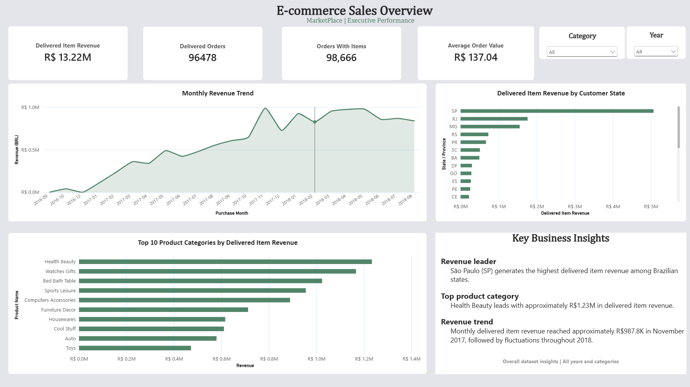

# Olist E-commerce Sales & Performance Analytics

An interactive Power BI report that helps marketplace analysts track delivered item value, identify the leading customer states and product categories, and reconcile headline KPIs against order-level and item-level records.

## What the report answers

- How did delivered item value change by purchase month?
- Which customer states and product categories contributed the most?
- How many orders reached delivered status, and how many had item records?

**Executive Overview** combines KPI cards, a monthly trend, a Top 10 category chart, a state comparison, and Year and Category slicers. The written insights describe the full dataset and stay fixed as slicers change. **Page 1** contains the analysis and validation views, including an order-status breakdown, revenue checks, category contribution and month-over-month measures.

## Dataset and preparation

The report uses historical Brazilian marketplace transactions from Olist. The analysis draws on orders, order items, customers, products and a Portuguese-to-English category lookup. Purchase timestamps span September 2016 to October 2018, with partial coverage at the edges. [Olist Brazilian E-Commerce Public Dataset](https://www.kaggle.com/datasets/olistbr/brazilian-ecommerce)

The Power Query workflow profiled missing values and used a left outer category lookup to retain products without an English match. The report uses a readable `category_display_name` field. Order headers join to item lines by `order_id`, customers provide the reporting state, products provide category attributes, and `DimDate` provides purchase-period grouping. Counts use order grain, while price and freight are additive at item grain. See the [model](docs/data_model.md) and [data quality checks](docs/data_quality.md).

## KPI reconciliation

| Metric | Definition | All data |
|---|---|---:|
| Total orders | Distinct order IDs in orders | 99,441 |
| Orders with items | Distinct order IDs with matching item lines | 98,666 |
| Delivered orders | Distinct order IDs with delivered status | 96,478 |
| Delivered item revenue | Sum of item prices for delivered orders | R$13,221,498.11 |
| Delivered average order value | Delivered item revenue divided by delivered orders | R$137.04 |

Amounts are in Brazilian reais. Delivered item revenue excludes freight and represents item value under the report's status rule. It does not measure recognized accounting revenue. See [metric definitions and DAX concepts](docs/metrics_and_dax.md).

## Findings

- **São Paulo (SP)** led customer states at **R$5.07 million** in delivered item revenue.
- **Health Beauty** led categories at **R$1.23 million**.
- **November 2017** was the highest purchase month in the supplied data at **R$987,765.37**.

The report covers a partial historical window. Purchase month reflects when orders were placed, while delivered status reflects their recorded outcome. See [findings and interpretation](docs/insights.md).

## Open the report

1. Download [Olist_Ecommerce_Analytics.pbix](Olist_Ecommerce_Analytics.pbix) and open it in Power BI Desktop.
2. Use the saved report to explore the visuals. For a refresh, [download the source CSVs](data/README.md).
3. In **Transform data**, update the CSV path in each relevant query's **Source** step, or change the source through **Data source settings** where available. Apply changes and select **Refresh**.

## Technical notes

This project demonstrates Power BI Desktop report design, Power Query (M) profiling and lookup joins, relationship modelling, DAX KPIs and time intelligence, and source-to-report reconciliation.

[Data dictionary](docs/data_dictionary.md) · [Interview preparation](docs/interview_prep.md)

